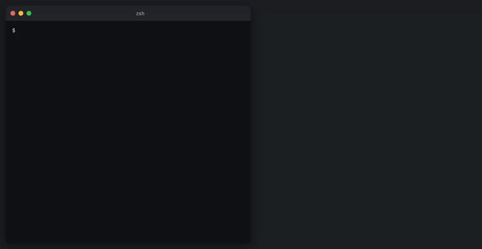

# readwebform


**Collect user input through a web form instead of the terminal.**

Interactive shell scripts are clunky. Prompting users with `read` or `readline` means no validation, no structure, and an ugly experience. What if you could pop open a real form in the browser instead?

`readwebform` launches a temporary local web server, serves a one-time form, waits for submission, then returns the data as JSON. The server shuts down automatically. Zero runtime dependencies, one command.



## Use Cases

- **Replace clunky terminal prompts** - Get structured input with validation, dropdowns, checkboxes, and file uploads instead of endless `read -p` calls
- **Collect sensitive input securely** - Passwords and API keys without terminal echo or shell history
- **Gather data from others on your network** - Send the temporary URL to a colleague; HTTPS supported for encryption
- **Human-in-the-loop for AI agents** - Provide a clean input mechanism for tools like Claude Code that need to pause and ask for user input

## Quick Start

```bash
readwebform --field name:text:Name:required --field email:email:Email:required
```

Your browser opens the form. The command **blocks** until the form is submitted or the timeout expires, then outputs:

```json
{
  "success": true,
  "fields": {
    "name": "Joe Smith",
    "email": "jsmith@example.com"
  },
  "files": {},
  "error": null
}
```

> **Tip:** Run `readwebform --help` to see all available options. Note that running `readwebform` with no arguments will wait for HTML input on stdin.

The browser is not launched, and only the URL is printed, when no desktop is detected (CI, an SSH session, no `DISPLAY`), when `--host` is not a loopback address (the URL is for someone else), or when `--url-file` is used (you are handling the URL yourself). `--no-launch-browser` always suppresses it, `READWEBFORM_NO_BROWSER=1` disables the automatic launch, and `--launch-browser` always forces it. Launch reporting is best effort: a browser that fails after it has been handed the URL is not detected. The Python API never opens a browser unless you pass `launch_browser=True`.

## Table of Contents

- [Features](#features)
- [Requirements](#requirements)
- [Installation](#installation)
- [Usage](#usage)
  - [Input Modes](#input-modes)
  - [Key Options](#key-options)
  - [Declarative Field Syntax](#declarative-field-syntax)
- [Output Formats](#output-formats)
- [Exit Codes](#exit-codes)
- [HTTPS Support](#https-support)
- [Security](#security)
- [Python API](#python-api)
- [Examples](#examples)
- [Development](#development)
- [Status](#status)
- [License](#license)
- [Contributing](#contributing)
- [Author](#author)

## Features

- **Ephemeral & Secure** - One-shot browser-based prompt with CSRF protection
- **Multiple Input Modes** - Inline HTML, HTML file, stdin, or declarative fields
- **Cross-Platform** - Works on Linux, macOS, and Windows
- **Zero Runtime Dependencies** - Uses only Python 3.9+ standard library
- **Flexible Output** - JSON or sanitized environment variables
- **File Upload Support** - With configurable size limits
- **Timeout Management** - Configurable timeouts with optional reset on validation errors
- **HTTPS Support** - Optional TLS encryption for remote access scenarios

## Requirements

- Python 3.9 or higher
- No external dependencies required at runtime

## Installation

```bash
# Run it without installing anything (uv)
uvx readwebform --field name:text:Name:required

# Or install the command
pipx install readwebform      # isolated, recommended
pip install readwebform       # into the current environment
```

For development, clone the repository and run `pip install -e ".[dev]"`.

> **Tip:** On Linux/macOS, pip may install the `readwebform` command to `~/.local/bin`. Ensure this directory is in your `PATH`.

## Usage

```
readwebform [options]
```

The command blocks until the form is submitted or the timeout expires. Only one submission is accepted per invocation.

### Input Modes

**Inline HTML:**
```bash
readwebform --html '<form><input name="name" required><input type="submit"></form>'
```

**Declarative fields:**
```bash
readwebform \
  --field name:text:Name:required \
  --field email:email:Email:required \
  --field comments:textarea:Comments:rows=4
```

**HTML file:**
```bash
readwebform --htmlfile ./form.html
```

**From stdin:**
```bash
cat form.html | readwebform
```

### Key Options

| Option | Description |
|--------|-------------|
| `--html "<string>"` | Inline HTML fragment or document containing one `<form>` element |
| `--htmlfile <path>` | Path to an HTML file containing a form |
| `--field <spec>` | Declaratively define form fields (repeatable) |
| `--title <string>` | Page title, shown as a heading above the form and in the browser tab (an existing `<title>` in a complete document is kept) |
| `--text <string>` | Instructional text shown above the form |
| `--host <ip>` | IPv4 or IPv6 address to bind to (default: `127.0.0.1`). With `0.0.0.0` or `::` the printed URL uses a best-effort guess of your machine's network address |
| `--url-host <host>` | Host name or address to put in the printed URL, for when the guess is wrong (VPNs, several interfaces) or you want a DNS name |
| `--port <int>` | TCP port (default: random available port) |
| `--cert <path>` | SSL certificate file (PEM) for HTTPS |
| `--key <path>` | SSL private key file (PEM) for HTTPS |
| `--max-file-size <limit>` | Maximum individual upload size (e.g., `5M`, `200K`) |
| `--max-total-size <limit>` | Maximum total request size (e.g., `20M`, `1G`; default `20M`) |
| `--upload-dir <path>` | Directory for uploaded files (default: a new temporary directory) |
| `--timeout <seconds>` | Max time to wait for submission, fractional allowed (default: `300`) |
| `--reset-timeout-on-error <bool>` | Reset timeout on recoverable errors (default: true) |
| `--json` | Output result as JSON (default; accepted for compatibility) |
| `--envfile <path>` | Write sanitized `export` statements to a file (mode `0600`) |
| `--print-env` | Print sanitized `export` statements to stdout instead of JSON |
| `--env-prefix <prefix>` | Prefix for environment variable names (default: `WEBFORM_`) |
| `--url-file <path>` | Write the form URL to this file |
| `--launch-browser [path]` | Open the form in a browser even when no desktop is detected, optionally with a specific browser executable |
| `--no-launch-browser` | Never open a browser; just print the URL. The environment variable `READWEBFORM_NO_BROWSER=1` disables the automatic launch for every run (an explicit `--launch-browser` still opens one) |
| `--no-submit-button` | Disable automatic submit button in declarative mode |
| `--no-cancel-button` | Disable cancel button in declarative mode |
| `--submit-label <text>` | Label for the submit button (default: "Submit") |
| `--cancel-label <text>` | Label for the cancel button (default: "Cancel") |
| `--version` | Print the version and exit |

### Declarative Field Syntax

```
--field name:type[:label][:options]
```

Quote a spec when it contains spaces or shell characters such as `|` and `*`:

```bash
--field "name:text:Full name:required"
--field "country:select:Country:options=US|UK|CA"
```

Labels and option values are always URL-decoded, quoted or not: `+` becomes a space (`Full+Name`), `%2C` a literal comma, `%3A` a literal colon, and a literal plus sign must be written `%2B` (`"lang:text:C%2B%2B"`).

**Supported types:** `text`, `email`, `password`, `number`, `date`, `time`, `datetime-local`, `month`, `week`, `url`, `tel`, `search`, `range`, `color`, `hidden`, `textarea`, `select`, `radio`, `checkbox`, `file`

**Options** (comma-separated; flags take no value):

| Option | Applies to | Meaning |
|--------|------------|---------|
| `required`, `readonly`, `disabled`, `autofocus` | most | HTML attributes of the same name |
| `placeholder=hint` | text-like, textarea | Placeholder text |
| `value=...` | all except file | Default value: the input text, the selected option(s), the checked radio, or the submitted value of a checkbox |
| `checked` | checkbox | Tick the box initially |
| `min=`, `max=`, `step=` | number, range, date/time | Range constraints |
| `minlength=`, `maxlength=`, `pattern=` | text-like, textarea | Length and regex constraints |
| `rows=`, `cols=` | textarea | Size |
| `options=a\|b\|c` | select, radio | Choices, separated by `\|` |
| `multiple` | select, file, email | Allow several values; for `select`, `value=a\|c` preselects several |
| `accept=.pdf,.docx` | file | Accepted file types (a literal comma is fine here) |

**Examples:**
```bash
--field "name:text:Full name:required,placeholder=Your name"
--field age:number:Age:min=0,max=120
--field "resume:file:Upload resume:accept=.pdf,.docx"
--field "country:select:Country:options=US|UK|CA,value=UK,required"
--field "plan:radio:Plan:options=free|pro,value=free"
--field "notify:checkbox:Email me updates:checked"
--field "photos:file:Photos:multiple,accept=image/*"
```

## Output Formats

### JSON (Default)

The JSON output always includes all four keys for consistent parsing:

```json
{
  "success": true,
  "fields": {
    "name": "Alice",
    "email": "alice@example.com"
  },
  "files": {
    "resume": {
      "filename": "cv.pdf",
      "path": "/tmp/readwebform_b73j3d/cv.pdf",
      "size": 48213,
      "content_type": "application/pdf"
    }
  },
  "error": null
}
```

A field that is submitted more than once (a checkbox group, a `select` with `multiple`) is a list of strings, and a file input with `multiple` is a list of file objects:

```json
{
  "fields": { "colours": ["red", "blue"] },
  "files": { "photos": [ { "filename": "a.jpg", "path": "..." }, { "filename": "b.jpg", "path": "..." } ] }
}
```

On timeout:
```json
{
  "success": false,
  "fields": {},
  "files": {},
  "error": "timeout"
}
```

On cancellation (user clicks Cancel button):
```json
{
  "success": false,
  "fields": {},
  "files": {},
  "error": "cancelled"
}
```

> **Note:** Timeout and cancellation are normal outcomes, not exceptions. `success: false` does not necessarily indicate an error condition.

### Environment Variables

```bash
readwebform --print-env --field name:text:Name --field email:email:Email
```

Output:
```bash
# WARNING: Environment files are for trusted local use only.
# Do not source envfiles generated from untrusted form data.
export WEBFORM_NAME=Alice
export WEBFORM_EMAIL=alice@example.com
```

Field names are upper-cased, prefixed with `WEBFORM_` (change it with `--env-prefix`), and any character that is not a letter, digit or underscore becomes an underscore, so `first-name` is `WEBFORM_FIRST_NAME`.

A repeated field such as a checkbox group produces the values joined by newlines (written as the literal two characters `\n`), plus a count and indexed variables:

```bash
export WEBFORM_COLOURS='red\nblue'
export WEBFORM_COLOURS_COUNT=2
export WEBFORM_COLOURS_1=red
export WEBFORM_COLOURS_2=blue
```

Uploaded files produce `WEBFORM_<NAME>_PATH` and `WEBFORM_<NAME>_FILENAME` (indexed as `_1_PATH`, `_2_PATH`... for a `multiple` file input). Envfiles are created with mode `0600` because they may contain submitted secrets.

### File Upload Cleanup

Uploaded files are stored in a temporary directory (e.g., `/tmp/readwebform_XXXX/`) created when the first file is saved, or in the directory given with `--upload-dir`. They are **not automatically deleted**. Your script is responsible for cleaning up these files after processing to avoid leaving sensitive data on disk.

## Exit Codes

| Code | Meaning |
|------|---------|
| 0 | Successful submission (valid JSON on stdout) |
| 1 | Internal error |
| 2 | Invalid HTML or missing form |
| 3 | Could not read input file |
| 5 | Timeout waiting for submission |
| 7 | User cancelled the form |
| 8 | Invalid argument |
| 130 | Interrupted (Ctrl+C) |

Codes 4 and 6 are reserved and never returned: a browser that fails to launch only produces a warning (the URL is still printed), and an upload over the size limit is rejected with HTTP 413 so the user can try again.

Exit code 0 with default output mode (`--json`) guarantees valid JSON on stdout. Timeout, cancellation and interruption also print the JSON envelope (with `"success": false`) unless `--print-env` is used.

## HTTPS Support

For remote access scenarios where data needs to be encrypted in transit, `readwebform` supports HTTPS with user-provided certificates.

> **Note:** For typical local usage on `127.0.0.1`, HTTP is fine. HTTPS is only needed when serving forms to other machines.

### Basic HTTPS Usage

```bash
readwebform --host 0.0.0.0 --port 8443 \
  --cert server.pem --key server-key.pem \
  --field password:password:Password
```

<details>
<summary><strong>Generating Certificates</strong></summary>

**For local development (recommended): [mkcert](https://github.com/FiloSottile/mkcert)**

Creates locally-trusted certificates with no browser warnings:

```bash
# One-time setup - installs local CA
mkcert -install

# Generate certificate
mkcert localhost 127.0.0.1

# Use with readwebform
readwebform --cert localhost+1.pem --key localhost+1-key.pem --port 8443 ...
```

**Quick self-signed certificate: openssl**

Browsers will show a security warning you must click through:

```bash
openssl req -x509 -newkey rsa:2048 -keyout key.pem -out cert.pem \
  -days 365 -nodes -subj '/CN=localhost'
```

**For production servers: [Let's Encrypt](https://letsencrypt.org/)**

Use [Certbot](https://certbot.eff.org/) to obtain free trusted certificates for public domains.

</details>

### Tips

- Use a fixed `--port` (e.g., 8443) with HTTPS so browsers remember the security exception
- Self-signed certificates require clicking through browser warnings each session
- For local development, `mkcert` provides the smoothest experience

## Security

The server automatically shuts down after a single form submission.

**Security features:**

- Defaults to `127.0.0.1` (localhost only)
- HTTPS support
- CSRF token protection for each session, and the form lives at a random URL path
- Exactly one submission is accepted; any later submission receives HTTP 410 and its files are discarded
- Every connection is handled on its own thread with a socket timeout, so an idle or half-open connection cannot stall the server
- Request bodies are capped (`--max-total-size`, default 20 MB) before they are read
- Uploaded filenames are reduced to a safe basename; files and envfiles are created with mode `0600`
- User-provided HTML is served as-is; generated forms (`--field`) contain no external resources or scripts
- Stateless and ephemeral by design

## Python API

> **Note:** The Python API was added as a convenience for those who prefer to integrate `readwebform` directly into Python scripts. The primary interface is the CLI.

You can use `readwebform` as a Python library:

### Basic Usage

```python
from readwebform import read_webform

# Pass any HTML form - URL printed to stderr
result = read_webform(
    '<form><input name="email" type="email" required><button>Submit</button></form>'
)

if result.success:
    email = result.fields['email']
    print(f"User entered: {email}")
elif result.error == 'cancelled':
    print("User cancelled the form")
else:
    print(f"Form failed: {result.error}")  # e.g., 'timeout'
```

**What happens:**
1. A local web server starts on `http://127.0.0.1:<random-port>`
2. The URL is printed to stderr (open manually, or use `launch_browser=True`)
3. The function **blocks** until the user submits the form or timeout expires
4. Returns a `FormResult` with the submitted data

### Declarative Forms

```python
from readwebform import read_webform_fields

result = read_webform_fields([
    {'name': 'name', 'type': 'text', 'label': 'Full Name', 'required': True},
    {'name': 'email', 'type': 'email', 'label': 'Email', 'required': True},
    {'name': 'age', 'type': 'number', 'label': 'Age', 'min': 0, 'max': 120}
], title="User Information", timeout=120, launch_browser=True)

if result.success:
    print(f"Name: {result.fields['name']}")
    print(f"Email: {result.fields['email']}")
    print(f"Age: {result.fields['age']}")
```

### File Uploads

```python
from readwebform import read_webform
import os

html = '''
<form enctype="multipart/form-data">
    <input type="file" name="document" accept=".pdf,.txt" required>
    <button>Upload</button>
</form>
'''

result = read_webform(html, max_file_size=10*1024*1024)  # 10 MB limit

if result.success and result.files and 'document' in result.files:
    doc = result.files['document']          # an UploadedFile
    print(f"{doc.filename} ({doc.size} bytes, {doc.content_type}) saved to {doc.path}")
    filepath = doc.path

    # Process the uploaded file
    with open(filepath, 'rb') as f:
        content = f.read()

    # IMPORTANT: Clean up uploaded files when done
    os.remove(filepath)
```

### Available Parameters

#### `read_webform(html, **kwargs)`

| Parameter | Default | Description |
|-----------|---------|-------------|
| `html` | (required) | HTML form content (fragment or complete document) |
| `timeout` | `300` | Maximum seconds to wait for submission |
| `launch_browser` | `False` | Open the browser. Unlike the CLI, the API never launches one unless asked |
| `browser_path` | `None` | Path to specific browser executable |
| `max_file_size` | `None` | Maximum individual file size in bytes |
| `max_total_size` | `None` | Maximum total upload size in bytes |
| `reset_timeout_on_error` | `True` | Reset timeout on validation errors |
| `host` | `'127.0.0.1'` | IPv4 or IPv6 address to bind to |
| `port` | `None` | Port to bind to (default: auto-select) |
| `cert_file`, `key_file` | `None` | PEM certificate and key to serve HTTPS |
| `url_file` | `None` | Write the form URL to this file once listening |
| `upload_dir` | `None` | Directory for uploads (default: temporary directory created on first upload) |

#### `read_webform_fields(fields, title=None, text=None, **kwargs)`

| Parameter | Default | Description |
|-----------|---------|-------------|
| `fields` | (required) | List of field specifications |
| `title` | `None` | Page title, shown as a heading above the form |
| `text` | `None` | Instructional text above form |
| `add_cancel_button` | `True` | Add a Cancel button |
| `cancel_label` | `'Cancel'` | Label for the Cancel button |
| `submit_label` | `'Submit'` | Label for the Submit button |

All other parameters same as `read_webform()`.

#### Field Specification

Each field is a `Field` dataclass (recommended, gives IDE completion) or a dict with the same keys:

```python
from readwebform import Field

Field(
    name='field_name',         # Required: field name
    type='text',               # Required: any type listed under "Declarative Field Syntax"
    label='Display Label',     # Optional: label shown to user
    required=True,             # Optional: whether field is required
    placeholder='hint',        # Optional: placeholder text
    value='default',           # Optional: default value (text, selected option(s), checked radio)
    checked=True,              # Optional: tick a checkbox initially
    min=0, max=100, step=1,    # Optional: for number/range/date fields
    minlength=2, maxlength=40, # Optional: for text-like fields
    pattern=r'[a-z]+',         # Optional: regex constraint
    rows=4, cols=50,           # Optional: for textarea
    options=['A', 'B'],        # Required for select/radio: list of choices
    multiple=True,             # Optional: select/file/email accept several values
    accept='.pdf,.txt',        # Optional: for file input
)
```

### Return Value: `FormResult`

```python
class FormResult:
    success: bool                      # True if form submitted, False if timeout/cancel
    fields: Optional[Dict[str, Union[str, List[str]]]]  # Field name -> value; repeated fields are lists (None if not success)
    files: Optional[Dict[str, Union[UploadedFile, List[UploadedFile]]]]  # None if no files
    error: Optional[str]               # 'timeout', 'cancelled', or other error

class UploadedFile:
    filename: str                      # Name supplied by the browser
    path: str                          # Where the file was saved
    size: int                          # Bytes
    content_type: str                  # MIME type supplied by the browser
```

## Examples

### Simple Contact Form

```bash
readwebform \
  --title "Contact Information" \
  --submit-label "Send" \
  --field name:text:Name:required \
  --field email:email:Email:required \
  --field message:textarea:Message:rows=5,required
```

### File Upload with Limits

```bash
readwebform \
  --html '<form enctype="multipart/form-data"><input type="file" name="doc" accept=".pdf"><button>Submit</button></form>' \
  --max-file-size 5M \
  --timeout 600
```

### Output to Environment File

```bash
readwebform --htmlfile form.html --envfile vars.env
source vars.env
echo "User entered: $WEBFORM_NAME"
```

### Use in Shell Script

```bash
#!/bin/bash
# Requires jq for JSON parsing: https://jqlang.github.io/jq/
result=$(readwebform --field name:text:Name:required --field age:number:Age)
name=$(echo "$result" | jq -r '.fields.name')
age=$(echo "$result" | jq -r '.fields.age')
echo "Hello $name, you are $age years old"
```

### Python: Complete Registration Form

```python
from readwebform import read_webform_fields

def get_user_registration():
    """Collect user registration data interactively."""

    fields = [
        {'name': 'username', 'type': 'text', 'label': 'Username',
         'required': True, 'placeholder': 'Choose a username'},
        {'name': 'email', 'type': 'email', 'label': 'Email Address',
         'required': True},
        {'name': 'password', 'type': 'password', 'label': 'Password',
         'required': True},
        {'name': 'age', 'type': 'number', 'label': 'Age',
         'min': 13, 'max': 120, 'required': True},
        {'name': 'country', 'type': 'select', 'label': 'Country',
         'options': ['USA', 'UK', 'Canada', 'Other'], 'required': True},
        {'name': 'bio', 'type': 'textarea', 'label': 'Bio',
         'rows': 4, 'placeholder': 'Tell us about yourself'},
        {'name': 'newsletter', 'type': 'checkbox', 'label': 'Subscribe to newsletter'},
    ]

    result = read_webform_fields(
        fields,
        title="User Registration",
        text="Please fill out the form below to register",
        timeout=300
    )

    if result.success:
        return {
            'username': result.fields['username'],
            'email': result.fields['email'],
            'password': result.fields['password'],
            'age': int(result.fields['age']),
            'country': result.fields['country'],
            'bio': result.fields.get('bio', ''),
            'newsletter': result.fields.get('newsletter') == 'on'
        }
    else:
        raise TimeoutError("User did not complete registration in time")

# Usage
try:
    user_data = get_user_registration()
    print(f"Registered user: {user_data['username']}")
except TimeoutError as e:
    print(f"Registration failed: {e}")
```

## Development

```bash
# Install in development mode with test and lint dependencies
pip install -e ".[test,dev]"

# Run all tests
python -m pytest tests/ -v

# Lint and type-check
ruff check src tests
pyright src

# Run only unit tests
python -m pytest tests/ -v --ignore=tests/test_integration.py

# Run only integration tests
python -m pytest tests/test_integration.py -v
```

### Demo GIF

`demo.gif` is generated, not screen-recorded: `demo/record_demo.py` runs a real `readwebform` process, drives Chromium through the form with Playwright, and records both panes in one page. See [demo/README.md](demo/README.md).

### Design Document

See [SPEC.md](SPEC.md) for the full design specification. This document covers architecture, security model, validation rules, and implementation details. It's intended for contributors and anyone wanting to implement `readwebform` in another programming language.

### Test Coverage

- **307 tests** across 12 files
  - Unit tests for the multipart parser, HTML rewriting, declarative forms, output formatting, CLI parsing and the Python API
  - Integration tests that run a real server on a random port: submissions, uploads, CSRF, size limits, timeouts, the CLI as a subprocess (exit codes 2, 5 and 130)
  - Hardening regressions: byte-exact uploads, UTF-8 filenames, repeated file fields, negative Content-Length, HTTP 410 on a second submission, listener release, concurrent servers, IPv6, idle HTTP and TLS connections
  - Threading, timeout, HTTPS (ephemeral certificates via `cryptography`, test dependency only) and browser-launch isolation tests
- CI runs the suite on Python 3.9 to 3.14 on Linux, plus macOS and Windows, and runs `ruff` and `pyright`

## Status

This is an **initial proof of concept**. The API and CLI interface may change based on user feedback. If you have suggestions or run into issues, please open an issue on GitHub.

## License

MIT License - see [LICENSE](LICENSE) file for details.

## Contributing

Contributions are welcome! Please feel free to submit a Pull Request.

## Author

**Vlad Lasky** - [https://github.com/vlasky](https://github.com/vlasky)
